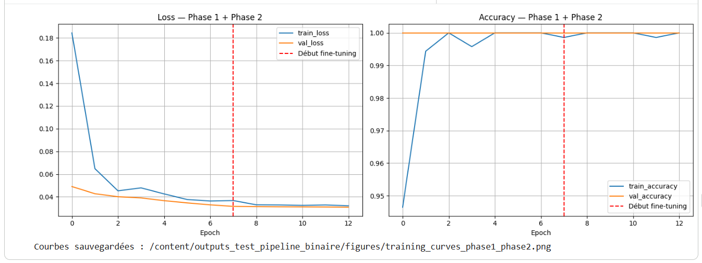
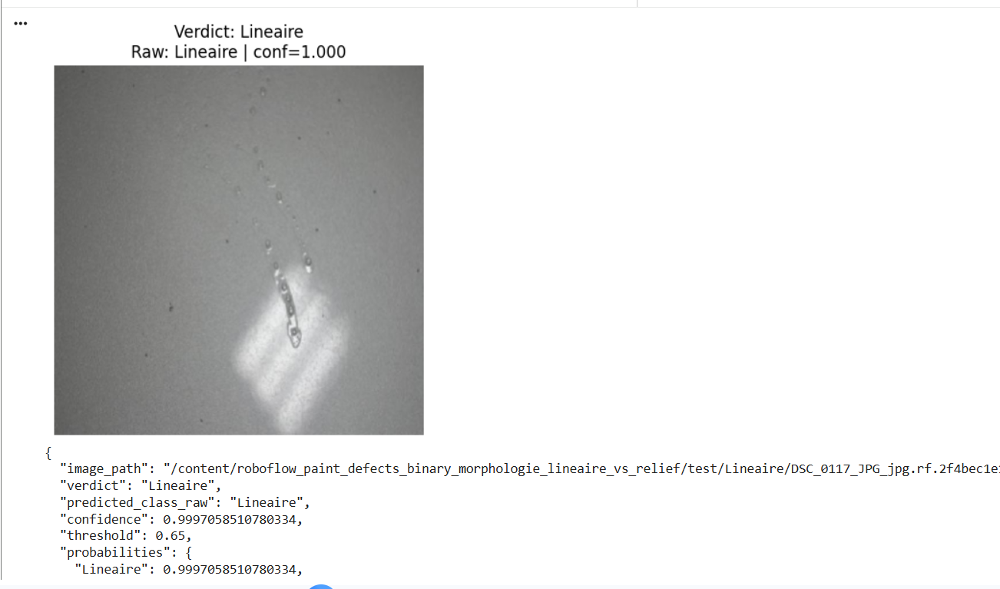
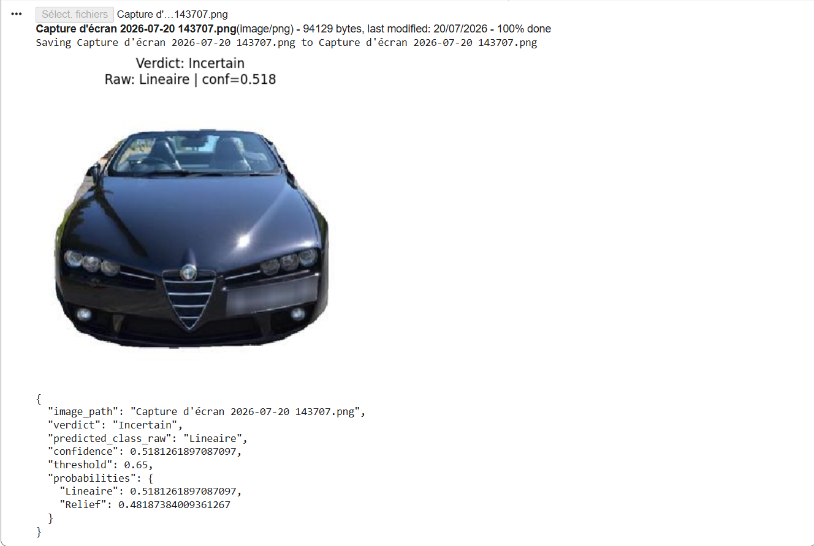

# Rapport d'observation : classification morphologique `Lineaire` vs `Relief`

**Projet :** MALLOULINOVA — Qualification fiable des pièces repeintes vs peinture d'origine
**Référence :** MALL-STG-ETE-2026-PAINT-01
**Semaine :** S4 — Développement du pipeline logiciel
**Notebook associé :** `tests/test_pipeline_binaire_optionB_morphologie.ipynb`
**Dataset source :** Roboflow Paint Defects réorganisé en 2 familles morphologiques
**Modèle :** EfficientNet-B0 pré-entraîné ImageNet
**Résolution :** 384 × 384 pixels
**Date d'exécution :** 2026-07-24

---

## 1. Objectif du test

Une Option a été proposée pour rendre le test binaire plus pertinent que le mapping simple `SCRATCH` vs `ORANGEPEEL`. Au lieu d'opposer deux classes isolées, le dataset Roboflow Paint Defects est regroupé selon une logique morphologique :

```text
Classe 0 = défauts linéaires / directionnels
Classe 1 = défauts de relief / texture de surface
```

L'objectif est de vérifier si le pipeline EfficientNet-B0 peut apprendre une séparation plus générale entre :

- les défauts à forme allongée ou directionnelle ;
- les défauts de relief local, bulles, cratères et textures de surface.

Ce test reste un **proxy technique**. Il ne constitue pas une validation métier réelle `Origine / Repeint`.

---

## 2. Mapping binaire utilisé

Le mapping appliqué dans le notebook est :

```python
CLASS_NAMES_TARGET = ["Lineaire", "Relief"]

BINARY_MAPPING = {
    "Lineaire": ["SCRATCH", "SAG"],
    "Relief": ["BLISTERING", "BUBBLES", "FISHEYE", "ORANGEPEEL", "SOLVENTPOP"],
}
```

| Classe pipeline | Classes Roboflow regroupées                                             | Interprétation morphologique                                         |
| --------------- | ------------------------------------------------------------------------ | --------------------------------------------------------------------- |
| `Lineaire`    | `SCRATCH`, `SAG`                                                     | rayures, coulures, défauts allongés ou directionnels                |
| `Relief`      | `BLISTERING`, `BUBBLES`, `FISHEYE`, `ORANGEPEEL`, `SOLVENTPOP` | bulles, cratères, peau d'orange, micro-reliefs et textures de vernis |

---

## 3. Distribution du dataset

D'après les sorties du notebook, le regroupement utilise l'ensemble des 7 classes Roboflow et donne :

| Classe          |          Train |    Validation |         Test |
| --------------- | -------------: | ------------: | -----------: |
| `Lineaire`    |            639 |            58 |           46 |
| `Relief`      |            783 |           110 |           37 |
| **Total** | **1422** | **168** | **83** |

Cette configuration est plus complète que le test précédent, qui n'utilisait que 55 images test. Ici, les 83 images du test set Roboflow sont exploitées.

---

## 4. Configuration d'entraînement

| Élément                   |                   Valeur |
| --------------------------- | -----------------------: |
| Backbone                    |          EfficientNet-B0 |
| Poids initiaux              |                 ImageNet |
| Taille d'entrée            |          384 × 384 × 3 |
| Batch size                  |                       16 |
| Loss                        | Categorical crossentropy |
| Optimiseur                  |                     Adam |
| Phase 1                     |           Backbone gelé |
| Epochs Phase 1              |                        8 |
| Learning rate Phase 1       |                     1e-3 |
| Phase 2                     |      Fine-tuning partiel |
| Couches trainables Phase 2  |                 23 / 238 |
| Epochs Phase 2              |                        5 |
| Learning rate Phase 2       |                     1e-5 |
| Seuil de rejet`Incertain` |                     0.65 |

---

## 5. Résultats d'entraînement



### 5.1. Phase 1 — backbone gelé

| Epoch | Train accuracy | Train loss | Val accuracy | Val loss |
| ----: | -------------: | ---------: | -----------: | -------: |
|     1 |         0.9121 |     0.2534 |       1.0000 |   0.0590 |
|     2 |         0.9796 |     0.1016 |       1.0000 |   0.0474 |
|     3 |         0.9831 |     0.0909 |       1.0000 |   0.0464 |
|     4 |         0.9909 |     0.0687 |       1.0000 |   0.0431 |
|     5 |         0.9866 |     0.0839 |       1.0000 |   0.0424 |
|     6 |         0.9930 |     0.0718 |       1.0000 |   0.0422 |
|     7 |         0.9944 |     0.0679 |       1.0000 |   0.0411 |
|     8 |         0.9916 |     0.0625 |       1.0000 |   0.0414 |

Le meilleur checkpoint de Phase 1 est obtenu à l'epoch 7, avec une `val_loss = 0.0411`. Les poids restaurés correspondent donc à cet epoch.

### 5.2. Phase 2 — fine-tuning partiel

| Epoch global | Train accuracy | Train loss | Val accuracy | Val loss |
| -----------: | -------------: | ---------: | -----------: | -------: |
|            9 |         0.9965 |     0.0572 |       1.0000 |   0.0408 |
|           10 |         0.9965 |     0.0507 |       1.0000 |   0.0405 |
|           11 |         0.9965 |     0.0516 |       1.0000 |   0.0404 |
|           12 |         0.9986 |     0.0549 |       1.0000 |   0.0403 |
|           13 |         0.9979 |     0.0492 |       1.0000 |   0.0402 |

La Phase 2 améliore légèrement la validation loss, de `0.0411` à `0.0402`. Le gain est faible mais cohérent : la tâche était déjà quasiment résolue par la tête de classification en Phase 1.

---

## 6. Résultats sur le jeu de test

| Métrique                              | Valeur |
| -------------------------------------- | -----: |
| Images test                            |     83 |
| Test loss                              | 0.0405 |
| Test accuracy Keras                    | 1.0000 |
| Accuracy sklearn                       | 1.0000 |
| Precision macro                        | 1.0000 |
| Recall macro                           | 1.0000 |
| F1-score macro                         | 1.0000 |
| AUC binaire, classe positive`Relief` | 1.0000 |
| Erreurs                                |      0 |
| Taux`Incertain` au seuil 0.65        |   0.0% |

### Classification report

| Classe                 |      Precision |         Recall |       F1-score |      Support |
| ---------------------- | -------------: | -------------: | -------------: | -----------: |
| `Lineaire`           |           1.00 |           1.00 |           1.00 |           46 |
| `Relief`             |           1.00 |           1.00 |           1.00 |           37 |
| **Accuracy**     |             — |             — | **1.00** | **83** |
| **Macro avg**    | **1.00** | **1.00** | **1.00** | **83** |
| **Weighted avg** | **1.00** | **1.00** | **1.00** | **83** |

### Analyse des erreurs

Le notebook indique :

```text
ANALYSE DES ERREURS : 0 erreurs sur 83 images
```

Aucune confusion n'a donc été observée entre les familles `Lineaire` et `Relief` sur le jeu de test.

---

## 7. Résultat de l'inférence individuelle

L'exemple affiché dans le notebook correspond à une image du dossier :

```text
/test/Lineaire/DSC_0117_JPG_...
```

Le modèle prédit :

```text
Verdict : Lineaire
Classe brute : Lineaire
Confiance : 0.9997 environ
Seuil : 0.65
```



Cette prédiction est cohérente avec le mapping  : l'image présente une coulure / trace allongée, assimilée à une morphologie linéaire ou directionnelle. La confiance est très élevée, ce qui explique l'absence de rejet `Incertain`.

---

## 8. Analyse du seuil `Incertain`

La grille de seuil montre que, pour la validation comme pour le test, tous les exemples sont acceptés même à un seuil élevé de 0.95 :

| Seuil | Validation acceptée | Test accepté | Accuracy sur acceptés |
| ----: | -------------------: | ------------: | ---------------------: |
|  0.50 |            168 / 168 |       83 / 83 |                   1.00 |
|  0.65 |            168 / 168 |       83 / 83 |                   1.00 |
|  0.80 |            168 / 168 |       83 / 83 |                   1.00 |
|  0.95 |            168 / 168 |       83 / 83 |                   1.00 |

Cela signifie que les prédictions sont fortement séparées et très confiantes. Dans ce test proxy, le seuil `Incertain = 0.65` ne filtre donc aucun cas.

**Interprétation :** le mécanisme de seuil fonctionne techniquement, mais ce dataset proxy ne permet pas d'optimiser réellement ce seuil. L'optimisation devra être faite sur le dataset propriétaire, où les cas ambigus seront plus fréquents.

---

## 9. Test complémentaire — image hors distribution rejetée en `Incertain`

Un test d'inférence supplémentaire a été réalisé avec une image externe uploadée manuellement dans Colab : une image globale de véhicule, et non un patch de défaut de peinture issu du dataset Roboflow.

Résultat obtenu :

```json
{
  "image_path": "Capture d'écran 2026-07-20 143707.png",
  "verdict": "Incertain",
  "predicted_class_raw": "Lineaire",
  "confidence": 0.5181261897087097,
  "threshold": 0.65,
  "probabilities": {
    "Lineaire": 0.5181261897087097,
    "Relief": 0.48187384009361267
  }
}
```



### 9.1. Interprétation

Le verdict final est `Incertain` car la confiance maximale du modèle est seulement :

```text
max(softmax) = 0.518 < seuil 0.65
```

Même si la classe brute la plus probable est `Lineaire`, l'écart entre les deux probabilités est très faible :

| Classe       | Probabilité |
| ------------ | -----------: |
| `Lineaire` |       0.5181 |
| `Relief`   |       0.4819 |

Le modèle hésite donc fortement. Le seuil de rejet joue correctement son rôle : il empêche le système de produire une décision trop confiante sur une image qui ne correspond pas au domaine d'entraînement.

### 9.2. Pourquoi ce résultat est important

Cette image est **hors distribution** (*out-of-distribution*) pour plusieurs raisons :

- elle représente un véhicule entier, pas un patch de défaut ;
- elle n'est pas une image macroscopique ;
- elle ne suit pas la structure Roboflow `Lineaire / Relief` ;
- elle ne contient pas nécessairement un défaut de peinture annoté ;
- l'échelle, le cadrage et le contenu visuel sont très différents des images d'entraînement.

Le fait que le modèle retourne `Incertain` est donc un comportement positif. Cela montre que le mécanisme de rejet peut servir de première barrière contre les entrées non conformes.

### 9.3. Lien avec le futur produit MALLOULIAUTO

Dans le produit final, une image globale de véhicule ne devrait pas être envoyée directement au classifieur patch `Origine / Repeint`. Le système devra d'abord vérifier que l'image respecte le protocole :

```text
patch macroscopique
surface proche
image nette
bonne exposition
distance Setup F correcte
zone de carrosserie exploitable
```

Ce test confirme donc l'intérêt d'ajouter une étape de contrôle qualité avant l'inférence finale. Si une image ne respecte pas le protocole, le système devra afficher un message du type :

> Image non conforme ou confiance insuffisante — veuillez reprendre une capture macroscopique avec le module Setup F.

### 9.4. Conclusion du test hors distribution

Ce test ne mesure pas la performance métier, mais il valide un comportement important du pipeline :

```text
entrée non conforme → confiance faible → verdict Incertain
```

Le seuil `Incertain = 0.65` fonctionne donc comme mécanisme de sécurité sur cette image externe.

---

## 10. Interprétation scientifique

### 10.1. Le pipeline est validé

Ce test confirme que la chaîne complète fonctionne avec un dataset binaire plus riche :

```text
7 classes Roboflow → 2 familles morphologiques → EfficientNet-B0 → évaluation → inférence
```

Tous les blocs logiciels sont validés :

| Bloc                                                       |  Statut |
| ---------------------------------------------------------- | ------: |
| Lecture`_classes.csv`                                    | Validé |
| Regroupement multi-classes vers 2 classes                  | Validé |
| Chargement Keras                                           | Validé |
| Data augmentation                                          | Validé |
| Phase 1 backbone gelé                                     | Validé |
| Phase 2 fine-tuning                                        | Validé |
| Classification report                                      | Validé |
| AUC binaire                                                | Validé |
| Seuil`Incertain`                                         | Validé |
| Inférence individuelle                                    | Validé |
| Export métriques / prédictions                           | Validé |
| Rejet d'une image hors distribution par seuil`Incertain` | Validé |

### 10.2. Pourquoi le score reste parfait ?

Même si ce test est plus complète que le test simple, les résultats restent parfaits pour plusieurs raisons :

1. **Les familles morphologiques sont très distinctes.**Les rayures/coulures et les défauts de relief présentent des motifs visuels très différents.
2. **EfficientNet-B0 est déjà très fort en extraction de textures.**Le backbone ImageNet sait déjà détecter contours, motifs locaux, contrastes et textures.
3. **Le dataset Roboflow peut contenir des augmentations proches.**Des images issues d'une même source peuvent se retrouver dans différents splits, ce qui rend la tâche plus facile.
4. **La tâche reste un proxy.**
   Elle ne reproduit pas la difficulté réelle de distinguer une peinture d'origine d'une pièce repeinte, où les différences peuvent être beaucoup plus subtiles.

### 10.3. Fine-tuning peu nécessaire sur ce proxy

La Phase 2 apporte un gain très faible sur la loss. Cela suggère que pour ce test public, la Phase 1 suffit presque entièrement. Toutefois, la Phase 2 doit rester dans le pipeline car elle sera importante sur le futur dataset propriétaire macroscopique, plus difficile.

---

## 11. Limites

| Limite                                  | Explication                                                                                                         | Impact                                                    |
| --------------------------------------- | ------------------------------------------------------------------------------------------------------------------- | --------------------------------------------------------- |
| Proxy non métier                       | `Lineaire` / `Relief` n'est pas `Origine` / `Repeint`                                                       | Les scores ne prouvent pas la performance produit         |
| Test set réduit                        | 83 images seulement                                                                                                 | Métriques encore fragiles                                |
| Splits Roboflow potentiellement proches | Augmentations ou images similaires entre splits                                                                     | Risque de score optimiste                                 |
| Domaine différent du Setup F           | Images Roboflow ≠ patches macro Apexel                                                                             | Généralisation non garantie                             |
| Pas de cas ambigus dans val/test        | Aucun rejet sur Roboflow même à 0.95 ; une image externe hors distribution est toutefois rejetée en`Incertain` | Seuil à optimiser plus tard sur le dataset propriétaire |

---

---

## 13. Conclusion

Le test valide avec succès le pipeline logiciel binaire sur une tâche morphologique plus riche :

```text
Lineaire vs Relief
```

Les résultats sont parfaits :

```text
Accuracy = 100%
F1-score macro = 100%
AUC = 1.0
Erreurs = 0 / 83
Taux Incertain = 0%
```

Ces résultats confirment que le pipeline EfficientNet-B0 est techniquement prêt : chargement, augmentation, entraînement en deux phases, évaluation, inférence, rejet par seuil `Incertain` et export fonctionnent correctement.

Cependant, le test reste un proxy. La validation scientifique finale devra être menée sur le dataset propriétaire macroscopique capturé avec le **Setup F : iPhone 14 Pro + module macroscopique Apexel tout-en-un**, avec les vraies classes métier :

```text
Origine / Repeint
```
