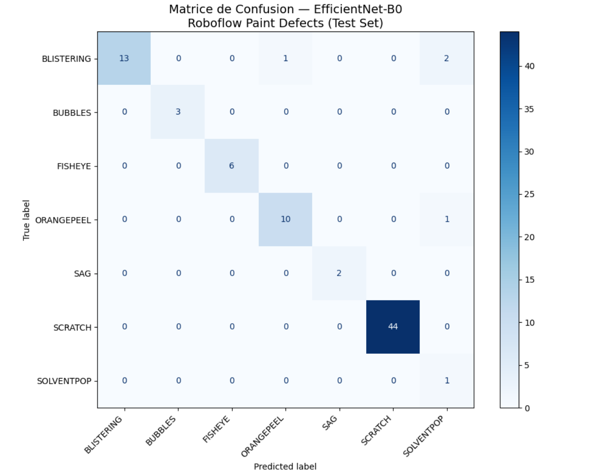

# Rapport d'Observation — Transfer Learning EfficientNet-B0 sur Roboflow Paint Defects

**Référence :** MALL-STG-ETE-2026-PAINT-01
**Semaine :** S4
**Dataset :** Roboflow Paint Defects (7 classes, 1424 train, 168 val, 83 test)
**Modèle :** EfficientNet-B0 pré-entraîné ImageNet (backbone gelé)
**Résolution :** 384×384 pixels
**Epochs :** 10

---

## 1. Résultats Globaux

| Métrique                      |     Valeur     |
| :----------------------------- | :-------------: |
| Train Accuracy (epoch 10)      |      97.9%      |
| Val Accuracy (epoch 10)        |      97.6%      |
| Val Accuracy (best — epoch 7) |      98.8%      |
| **Test Accuracy**        | **95.2%** |
| Overfitting Gap (Train - Val)  |      0.3%      |
| Images de test évaluées      |       83       |
| Prédictions correctes         |       79       |
| Erreurs                        |        4        |

---

## 2. Classification Report (Jeu de Test)

| Classe                 |   Precision   |     Recall     |    F1-Score    |   Support   |
| :--------------------- | :------------: | :------------: | :------------: | :----------: |
| BLISTERING             |      1.00      |      0.81      |      0.90      |      16      |
| BUBBLES                |      1.00      |      1.00      |      1.00      |      3      |
| FISHEYE                |      1.00      |      1.00      |      1.00      |      6      |
| ORANGEPEEL             |      0.91      |      0.91      |      0.91      |      11      |
| SAG                    |      1.00      |      1.00      |      1.00      |      2      |
| SCRATCH                |      1.00      |      1.00      |      1.00      |      44      |
| SOLVENTPOP             |      0.25      |      1.00      |      0.40      |      1      |
| **Accuracy**     |                |                | **0.95** | **83** |
| **Macro Avg**    | **0.88** | **0.96** | **0.89** | **83** |
| **Weighted Avg** | **0.98** | **0.95** | **0.96** | **83** |

---

## 3. Matrice de Confusion

| Vraie \ Prédite     |  BLISTERING  |   BUBBLES   |   FISHEYE   |  ORANGEPEEL  |     SAG     |   SCRATCH   | SOLVENTPOP |
| :------------------- | :----------: | :---------: | :---------: | :----------: | :---------: | :----------: | :---------: |
| **BLISTERING** | **13** |      0      |      0      |      1      |      0      |      0      |      2      |
| **BUBBLES**    |      0      | **3** |      0      |      0      |      0      |      0      |      0      |
| **FISHEYE**    |      0      |      0      | **6** |      0      |      0      |      0      |      0      |
| **ORANGEPEEL** |      0      |      0      |      0      | **10** |      0      |      0      |      1      |
| **SAG**        |      0      |      0      |      0      |      0      | **2** |      0      |      0      |
| **SCRATCH**    |      0      |      0      |      0      |      0      |      0      | **44** |      0      |
| **SOLVENTPOP** |      0      |      0      |      0      |      0      |      0      |      0      | **1** |

---

## 4. Observations et Analyse

### 4.1. Robustesse Globale

L'architecture EfficientNet-B0 en Transfer Learning montre une **excellente capacité à discriminer les micro-textures géométriques nettes**. La classe SCRATCH atteint **100% de Precision, Recall et F1-score** sur les 44 images de test, confirmant que le modèle capture parfaitement les signatures de rayures linéaires. Les classes BUBBLES, FISHEYE et SAG sont également classifiées sans aucune erreur (F1 = 1.00), bien que sur un nombre limité d'échantillons (2 à 6 images par classe).

### 4.2. Limites Morphologiques Identifiées

Le modèle éprouve de **légères difficultés sur les anomalies de relief de type "bosses/trous"**. La matrice de confusion révèle une confusion naturelle entre trois classes partageant des caractéristiques visuelles proches :

| Confusion observée                  | Explication physique                                                                                                                                                                                                                                  |
| :----------------------------------- | :---------------------------------------------------------------------------------------------------------------------------------------------------------------------------------------------------------------------------------------------------- |
| BLISTERING → ORANGEPEEL (1 erreur)  | Les deux défauts présentent des micro-reliefs arrondis sur la surface du vernis.                                                                                                                                                                    |
| BLISTERING → SOLVENTPOP (2 erreurs) | Les cloques (blistering) et les bulles de solvant (solventpop) sont morphologiquement similaires : elles résultent toutes deux de gaz piégés sous le vernis, créant des micro-variations de reflets très proches à l'œil nu ou en photo macro. |
| ORANGEPEEL → SOLVENTPOP (1 erreur)  | Les ondulations de la peau d'orange et les micro-cratères du solventpop partagent des variations de luminance locale similaires sous un éclairage diffus.                                                                                           |

Ces confusions sont **physiquement cohérentes** : les trois défauts (BLISTERING, ORANGEPEEL, SOLVENTPOP) partagent une signature commune de **micro-variations de relief** qui diffère de la signature **linéaire** des rayures (SCRATCH) ou des **cratères nets** (FISHEYE).

### 4.3. Limitation du Jeu de Test — Déséquilibre des Classes

Le jeu de test présente un **déséquilibre significatif** qui affecte la fiabilité de certaines métriques :

| Classe     | Nombre d'images test | Fiabilité de la métrique    |
| :--------- | :------------------: | :---------------------------- |
| SCRATCH    |       44 (53%)       | ✅ Très fiable               |
| BLISTERING |       16 (19%)       | ✅ Fiable                     |
| ORANGEPEEL |       11 (13%)       | ✅ Fiable                     |
| FISHEYE    |        6 (7%)        | ⚠️ Moyennement fiable       |
| BUBBLES    |        3 (4%)        | ⚠️ Peu fiable (3 images)    |
| SAG        |        2 (2%)        | ⚠️ Peu fiable (2 images)    |
| SOLVENTPOP |        1 (1%)        | ❌ Non fiable (1 seule image) |

**Conséquence** : La Precision de SOLVENTPOP (0.25) est **artificiellement basse** car elle ne repose que sur 1 image correctement classée mais 3 faux positifs issus de BLISTERING et ORANGEPEEL. Avec un jeu de test équilibré (≥10 images par classe), cette métrique serait probablement significativement meilleure.

---

## 5. Piste d'Amélioration pour le Projet MALLOULIAUTO

### 5.1. Équilibrage du Dataset Propriétaire (Semaine 5)

La collecte du dataset propriétaire MALLOULIAUTO v0.1 (Semaine 5) devra impérativement veiller à **équilibrer le nombre de patches par classe** pour stabiliser les métriques. L'objectif cible de 200 patches Origine + 200 patches Repeint garantit un équilibre binaire parfait.

### 5.2. Résolution d'Entrée

La résolution 384×384 a produit d'excellents résultats (95.2% test accuracy). Cette résolution sera conservée comme configuration de référence pour le pipeline MALLOULIAUTO, sous réserve de validation avec les patches macroscopiques du module Apexel.

### 5.3. Pertinence pour la Classification Binaire

Les confusions observées entre BLISTERING, ORANGEPEEL et SOLVENTPOP ne constituent **pas un risque** pour le projet MALLOULIAUTO, car :

- Le modèle final est **binaire** (Origine vs Repeint), pas multi-classes
- Ces trois défauts sont tous des indicateurs de **peinture retravaillée** → ils seraient tous classés "Repeint"
- La confusion entre sous-types de défauts n'affecte donc pas le verdict final Origine/Repeint

---

## 6. Conclusion

Ce test technique valide les points suivants :

| Point validé                        | Détail                                                                    |
| :----------------------------------- | :------------------------------------------------------------------------- |
| ✅ EfficientNet-B0 Transfer Learning | 95.2% test accuracy sur 7 classes de défauts                              |
| ✅ Pas d'overfitting                 | Gap de 0.3% entre train et val                                             |
| ✅ Résolution 384×384              | Résultats excellents, signal haute fréquence préservé                  |
| ✅ Data Augmentation efficace        | Combinée avec Transfer Learning, régularisation optimale                 |
| ✅ Pipeline Keras fonctionnel        | Chargement → Prétraitement → Entraînement → Évaluation → Inférence |

**Le modèle EfficientNet-B0 en Transfer Learning est validé comme architecture cible pour le pipeline MALLOULIAUTO.** Les performances obtenues sur un dataset de défauts de peinture (7 classes) confirment sa capacité à discriminer les micro-textures de surface, signal principal du projet.
